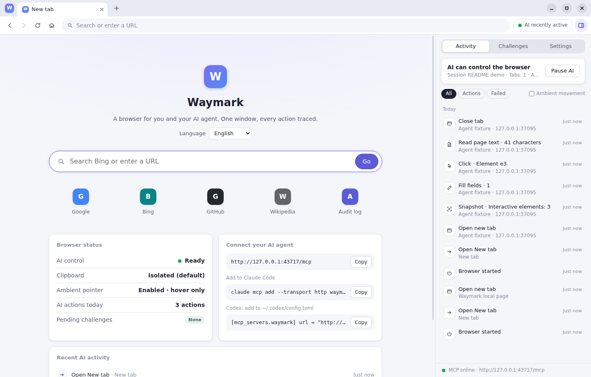
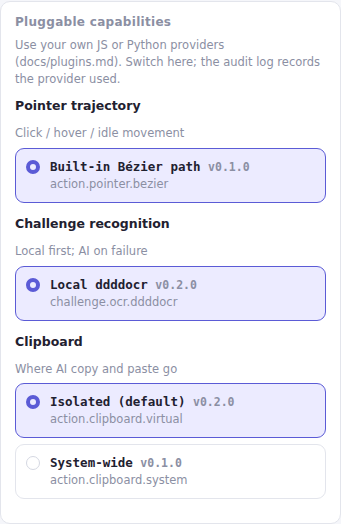
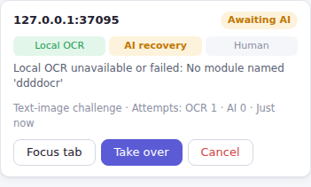
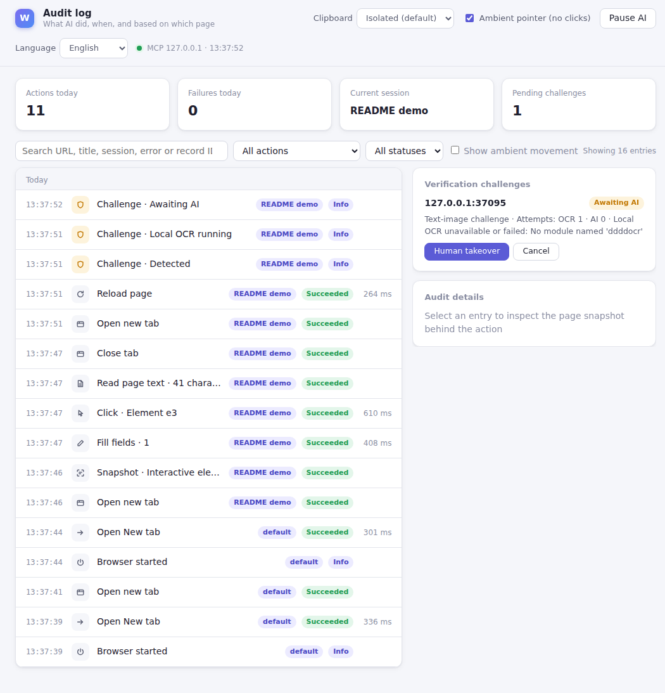

<p align="center"></p>

<h1 align="center">Waymark</h1>

<p align="center"><b>The open-source desktop browser that AI agents and people share.</b><br>
Automation first, AI second, people last. Every automation step is pluggable, and every action is traced.</p>

<p align="center">
<a href="https://pypi.org/project/waymark-browser/"></a>
<a href="https://github.com/guangxiangdebizi/waymark-browser/actions/workflows/ci.yml"></a>
<a href="LICENSE"></a>
<a href="README.zh-CN.md">中文</a>
</p>



## Automation first. AI second. People last.

Most agent browsers send everything to the model, and when the model gets stuck they send it to a person. Model calls are not free. Every screenshot, retry and "move the mouse a bit" costs tokens, latency and money. Waymark puts a **deterministic automation layer in front of the model**:

| Step | Who handles it | Examples |
|---|---|---|
| 1. **Automation** | The browser itself, locally and at no token cost | Pointer paths, waits and settling, scroll-into-view, isolated clipboard, local OCR on text CAPTCHAs (`ddddocr`), challenge detection |
| 2. **AI** | Your agent, only for the decisions that need it, with a fixed retry budget | Which element to click, what to type, recovering from challenges automation could not clear |
| 3. **People** | You, only when both of the above give up | Hard CAPTCHAs, logins, approvals. The page freezes for automation and the task resumes from its checkpoint |

The agent says *click e12*. Everything below that sentence is the browser's job, and the agent's context stays small.

## Every automation step is a plugin

The automation layer is a set of **capability slots**. Each slot has a built-in default, and you can swap in your own JavaScript module or a process in any language, for example a Python model trained on your own data. You can switch providers at runtime from the side panel or the API. Every ledger entry records which provider and version did the work.

| Slot | Built-in | Bring your own |
|---|---|---|
| **Pointer movement**: every agent click, hover and idle movement | Curved Bézier path | [Minimum-jerk reach with Fitts-law timing](examples/plugins/pointer-minimum-jerk.mjs), [WindMouse in Python](examples/plugins/pointer_model.py), or your own model trained on recorded mouse traces |
| **Keyboard**: every character the agent types | Human-paced typing: key hold time, uneven gaps, word pauses, corrected typos | Your own typing-cadence model, or `action.keyboard.fast` when speed matters more |
| **CAPTCHA solving**: the first step in the challenge chain | Local `ddddocr` worker | [Any OCR engine or fine-tuned model in a separate process](examples/plugins/ocr_solver.py) |
| **Clipboard**: where agent copy and paste go | Isolated per-session clipboard; system clipboard on request | Any provider with `read` / `write` / paste |

Many sites look at *how* input arrives: pointer paths, speed profiles, hover and dwell, key hold and press timing. A click that teleports to the centre of a button, or text that appears 60 characters a second with 0 ms key holds, looks nothing like a person, so input behaviour should be a model you control rather than a constant. Plugins only compute results: a path from coordinates, text from an image. Waymark executes them, so a plugin never sees the page, cookies or DOM. A plugin that throws or times out falls back to the built-in, and the agent's action still succeeds. See [docs/plugins.md](docs/plugins.md).

<p align="center"></p>

## Measured against a published AI-agent detector

[AgentShield](https://arxiv.org/abs/2610.41181) (IEEE S&P 2027) spots browser agents by how they fill in forms. We gave the
same model (DeepSeek V4.1 Flash) the paper's task through browser-use and through Waymark, 10 sessions per form, and scored
them with the paper's own detector (0 = human, 1 = automated):

| Form | Humans (paper) | browser-use | Waymark 0.4.0 |
|---|---|---|---|
| Simple form | 0.03 | 1.00 | **0.00** |
| Dynamic form, 22 fields revealed one by one | 0.04 | 0.96 | **0.05** |
| Key hold / pointer moves per session (dynamic) | 108 ms / 175 | 11 ms / 0 | 121 ms / 172 |

All Waymark sessions submitted the form. The remaining tell is speed: Waymark's median reaction is slower than a person's.
Method, caveats and raw data: [docs/benchmark-agentshield.md](docs/benchmark-agentshield.md).

## What else you get

- **A real browser window you can use.** Tabs, omnibox, back/forward, context menus and shortcuts all work. The pages the agent works in are ordinary tabs, marked with an `AI` badge.
- **Eight interface languages.** English (default), Simplified Chinese, Japanese, Korean, Spanish, French, German and Portuguese. Choose **Settings → Language**, or use the selector on the start page or audit page. Your choice is saved across restarts.
- **MCP endpoint for any agent.** `tabs`, `navigate`, `snapshot`, `read`, `act`, `wait`, `challenge`, `audit`, `capabilities`. Works with Claude Code, Codex, Cursor and anything that speaks MCP over HTTP or stdio.
- **Traceable actions.** Every navigation, click, fill and read is written to a local ledger. Each entry records the session, before and after URLs, duration, the provider that ran it, and the SHA-256 of the snapshot it was based on. Click any step in the side panel or on `/audit` to see the element the agent targeted.
- **Isolated input by default.** Agent mouse and keyboard events go only to the target tab. Clipboard operations go to a per-session virtual clipboard, so your system clipboard and cursor stay yours. A global clipboard mode is one switch away.
- **Ambient pointer.** On idle pages the pointer can wander over non-interactive areas. It only hovers and never clicks. Clicks happen only when the agent asks for them.
- **You hold the lease.** Press *Pause AI* and every agent read and write is refused until you resume.
- **Untrusted content stays data.** Page-derived tool output is wrapped in nonce-tagged `UNTRUSTED_PAGE_CONTENT` markers. Password values never enter snapshots, and fill values and OCR answers never reach the ledger.

<table>
<tr>
<td></td>
<td></td>
</tr>
<tr>
<td align="center">CAPTCHA jobs: local OCR → AI → you</td>
<td align="center">Full audit ledger with search and per-action detail</td>
</tr>
</table>

## Quick start

You need **Node.js 22+** and Python 3.9+.

```bash
pip install waymark-browser        # add [ocr] for local ddddocr: pip install "waymark-browser[ocr]"
waymark setup                      # downloads and builds the app into ~/.waymark/app
waymark start                      # opens the browser; MCP at http://127.0.0.1:9510/mcp
```

From source instead:

```bash
git clone https://github.com/guangxiangdebizi/waymark-browser && cd waymark-browser
npm ci && npm run app
```

On a headless Linux box, wrap it: `xvfb-run -a waymark start --foreground`.

### Connect your agent

```bash
# Claude Code
claude mcp add --transport http waymark http://127.0.0.1:9510/mcp
```

```toml
# Codex: ~/.codex/config.toml
[mcp_servers.waymark]
url = "http://127.0.0.1:9510/mcp"
```

```json
// stdio-only clients
{ "mcpServers": { "waymark": { "command": "waymark", "args": ["mcp", "--autostart"] } } }
```

### Or drive it from the terminal

```bash
waymark open https://example.com     # Opened tab 2
waymark snapshot 2                   # [ref=e1] a "Learn more"
waymark click 2 e1
waymark read 2 --limit 2000
waymark audit                        # the ledger, newest last
waymark pause                        # agents are refused until `waymark resume`
```

See [`cli/README.md`](cli/README.md) for every command.

UI language does not change website content, user input, raw audit records or MCP fields. CLI commands and diagnostics remain in English. See [localization](docs/localization.md) to add or edit translations.

## MCP tools

| Tool | Purpose |
|---|---|
| `name_session` | Label the agent session; the name is attached to every ledger entry |
| `tabs` | list / new / active / close |
| `navigate` | url / back / forward / reload; returns any detected challenge |
| `snapshot` | Elements a person can see, with refs (`e1`, `e2`, ...), labels and state (selected option, checked, filled) |
| `read` | Visible text, or the rendered DOM with `format: "html"`; reports truncation |
| `act` | click, fill, select, type, paste, copy, press, scroll, hover by ref; pointer and keyboard run locally, and the result lists what appeared, disappeared or changed |
| `wait` | Text, CSS selector or duration (max 30 s) |
| `challenge` | Inspect or advance OCR → AI → human challenge jobs |
| `audit` | Read the ledger and the snapshot behind any action |
| `capabilities` | Registered local providers (pointer, keyboard, clipboard, OCR) with versions and data-egress flags |

## How it fits together

```text
AI agent ──MCP──▶ Waymark runtime ─────────────▶ Electron WebContentsView tabs
                    │  BrowserRuntime   snapshots, refs, actions, pause lease
                    │  ChallengeBroker  detect → ddddocr → AI budget → human
                    │  Capability slots pointer · keyboard · CAPTCHA/OCR · clipboard, built-in or plugin
                    └  AuditLog         events.jsonl + hashed snapshots → side panel & /audit
```

The Electron shell owns the window, tabs and side panel. The runtime drives tabs through Playwright's Electron channel. The same runtime can also drive a stock Chrome profile (`npm run dev`) as a reference adapter. Design notes are in [`docs/`](docs) (Chinese): [architecture](docs/architecture.md), [requirements](docs/requirements.md), [desktop app](docs/desktop-app.md), [BrowserOS neo compatibility](docs/neo-compatibility.md) and the [design review](docs/design-review.md).

## Configuration

| Setting | Where |
|---|---|
| Port, profile and audit directory, OCR budget, plugins | `config/electron.json` |
| Clipboard mode, pointer and keyboard models, ambient pointer, plugins, start-page shortcuts | `data/electron-settings.json`, also written by the side panel |
| `WAYMARK_PORT`, `WAYMARK_PYTHON`, `WAYMARK_CONFIG`, `WAYMARK_ELECTRON_ARGS` | Environment |

Example start-page shortcuts in `data/electron-settings.json`:

```json
{ "home": { "quickLinks": [ { "name": "Docs", "url": "https://docs.example.com", "color": "#0c8484" } ] } }
```

## Responsible use

Waymark exists to take repetitive, low-value work off people on sites they are allowed to automate. Local OCR covers simple text-image challenges, and input models make automated sessions behave consistently. Neither is a guarantee against any particular site's bot protection. Respect each site's terms. When a challenge needs a person, Waymark stops and asks you. A `resolved_unverified` challenge only means that stage ended, so verify the business result before continuing.

The control API listens on `127.0.0.1` only. It refuses cross-origin and non-JSON writes so that other web pages cannot toggle settings.

## Status

Early but used daily. Implemented: the desktop shell, the MCP tools above, pluggable pointer and keyboard models, the isolated clipboard, the ambient pointer, the challenge pipeline, the ledger, the CLI and an eight-language UI. Next slots: action pacing, scrolling, and slider or click-order challenge solvers. Planned: installers and auto-update, a full accessibility tree and iframe refs, file upload and download, screenshots, a password vault and profile import, and a tamper-evident ledger.

## Development

```bash
npm ci
npm run build && npm test          # unit tests
npm run app                        # launch the desktop app
npm run test:electron              # end-to-end against the running app
cd cli && python -m unittest discover -s tests
```

Contributions are welcome. See [CONTRIBUTING.md](CONTRIBUTING.md).

## License

[MIT](LICENSE)
