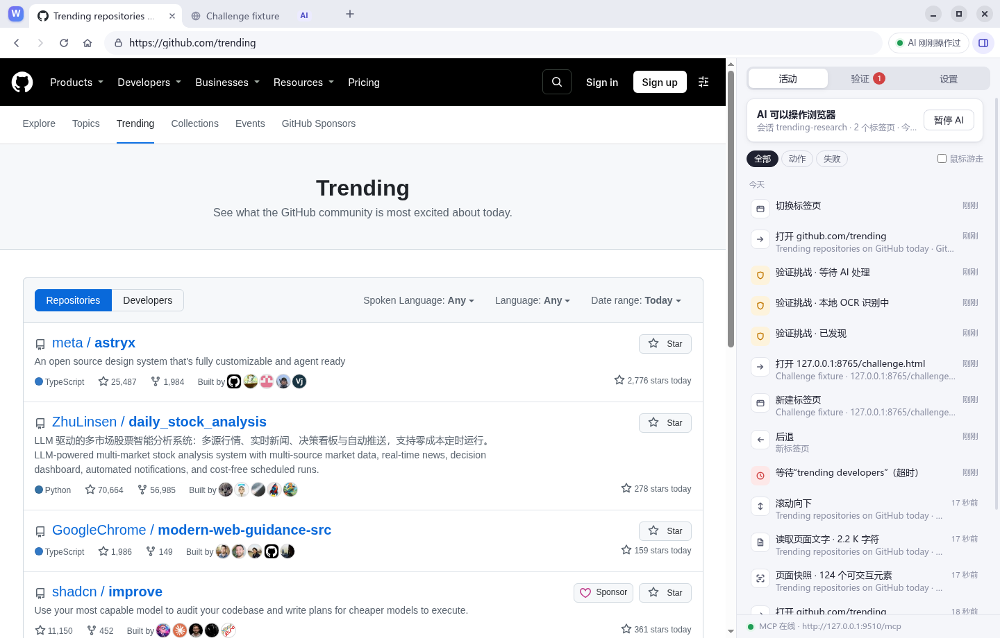
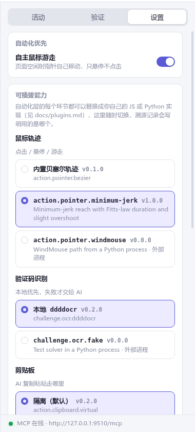
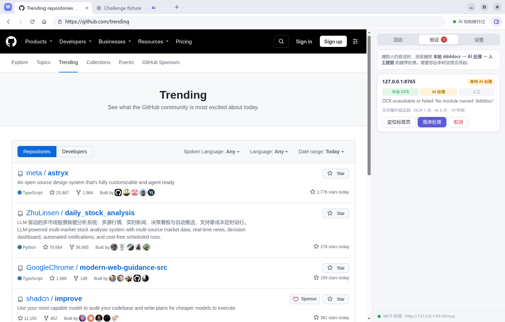
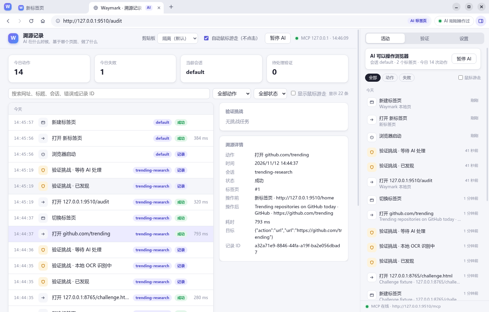

<p align="center"></p>

<h1 align="center">Waymark</h1>

<p align="center"><b>你和 AI 共用的开源桌面浏览器。</b><br>
自动化优先，AI 其次，人工兜底；自动化层每个环节都可插拔，AI 的每一步都可追溯。</p>

<p align="center">
<a href="https://pypi.org/project/waymark-browser/"></a>
<a href="https://github.com/guangxiangdebizi/waymark-browser/actions/workflows/ci.yml"></a>
<a href="LICENSE"></a>
<a href="README.md">English</a>
</p>



支持 **English（默认）、简体中文、日本語、한국어、Español、Français、Deutsch、Português**。在 **Settings → Language** 中选择“简体中文”，也可在首页或溯源页切换。语言偏好会保存，重启后仍生效。网页内容、用户输入、原始审计记录及 MCP 字段保持原样；CLI 命令和诊断仍为英文。详见[多语言说明](docs/localization.md)。

## 自动化优先 → AI 其次 → 人工兜底

现在大多数 AI 浏览器的做法是：什么都先丢给大模型，模型搞不定再叫人。可是 AI 调用本身也是成本。每一次截图、重试、"鼠标再往左挪一点"都在花 token、时间和钱。Waymark 在模型前面加了一层**确定性的自动化层**：

| 层级 | 谁来做 | 例子 |
|---|---|---|
| 1. **自动化** | 浏览器自己在本地完成，不花 token | 鼠标轨迹、等待页面稳定、滚动到可见、隔离剪贴板、本地 ddddocr 识别文字验证码、验证检测 |
| 2. **AI** | 你的 agent 只做真正需要判断的事，并且有重试预算 | 点哪个元素、填什么内容、处理自动化没搞定的验证 |
| 3. **人工** | 只有前两层都放弃时才叫你 | 难验证码、登录、需要本人确认的操作；接管时页面冻结自动化，完成后从断点继续 |

AI 只需要说一句"点击 e12"，剩下的都是浏览器的事，AI 的上下文也就小得多。

## 自动化层的每个环节都可插拔

自动化层由一组**能力插槽**组成。每个插槽都有内置实现，也可以换成你自己的 JS 模块，或任意语言写的外部进程（比如用你自己数据训练的 Python 模型）。侧栏和 API 都能随时切换，溯源记录会写明每次用的是哪个实现、哪个版本。

| 插槽 | 内置实现 | 可以换成 |
|---|---|---|
| **鼠标轨迹**：AI 的每次点击、悬停和空闲游走 | 贝塞尔曲线轨迹 | [最小加加速度 + 费茨定律模型](examples/plugins/pointer-minimum-jerk.mjs)、[Python 写的 WindMouse](examples/plugins/pointer_model.py)、你用真人鼠标数据训练的模型 |
| **键盘输入**：AI 输入的每一个字 | 拟人打字：按键按下时长、参差不齐的间隔、词间停顿、偶尔打错再改 | 你自己的打字节奏模型；更看重速度时用 `action.keyboard.fast` |
| **操作节奏**：AI 的每一步什么时候开始 | 补上真人的反应和阅读时间，只在 AI 回得比人快时才等 | [固定思考时间](examples/plugins/pacing-fixed.mjs)、你自己的反应时间模型 |
| **空闲行为**：AI 思考时指针做什么 | 看新出现的内容、跟着文字读、停顿、点空白处、滚一点再滚回、偶尔点开链接看一眼，AI 下一步之前全部复原 | [逐行阅读](examples/plugins/idle-reader.mjs)；只想悬停用 `idle.drift` |
| **验证码识别**：验证处理链的第一步 | 本地 ddddocr | [外部进程里的任意 OCR 引擎或微调模型](examples/plugins/ocr_solver.py) |
| **剪贴板**：AI 的复制粘贴走哪里 | 会话内隔离剪贴板，可切换到系统剪贴板 | 任何实现了 read / write / 粘贴的提供器 |

很多网站会看输入是*怎么*来的：鼠标轨迹、速度曲线、悬停停留、按键按下时长和节奏。瞬移到按钮正中心的点击、按下 0 毫秒且每秒 60 个字的输入，都和真人完全不像，所以输入行为应该是一个由你掌控的模型，而不是写死的常量。插件只负责计算：给坐标、算路径，给图片、出文字。真正执行的是浏览器，所以插件碰不到页面、Cookie 和 DOM。插件报错或超时会自动退回内置实现，不会让 AI 的操作失败。详见 [docs/plugins.md](docs/plugins.md)。

<p align="center"></p>

## 用公开的 AI Agent 检测器实测

[AgentShield](https://arxiv.org/abs/2610.41181)（IEEE S&P 2027）通过填表行为识别浏览器 Agent。我们让同一个模型（DeepSeek V4.1 Flash）
分别通过 browser-use 和 Waymark 执行论文原文的任务，每种表单各 10 次，再用论文自带的检测模型打分（0 = 真人，1 = 自动化）：

| 表单 | 真人（论文） | browser-use | Waymark 0.4.0 | Waymark 0.5.0 |
|---|---|---|---|---|
| 简单表单 | 0.03 | 1.00 | **0.00** | **0.00** |
| 动态表单（22 个字段逐个出现） | 0.04 | 0.96 | **0.05** | **0.13** |
| 按键时长 / 每会话鼠标移动（动态表单） | 108 ms / 175 | 11 ms / 0 | 121 ms / 172 | 115 ms / 151 |
| 反应时间中位数（动态表单） | 3.3 s | 4.8 s | 8.1 s | 6.6 s |

Waymark 的所有会话都成功提交了表单。0.5.0 没有一个会话的按键时长、鼠标移动或反应时间超出真人范围，反应也更接近真人。
它仍然比真人慢，剩下的差距是 LLM 往返的时间。
方法、注意事项和原始数据见 [docs/benchmark-agentshield.md](docs/benchmark-agentshield.md)（英文）。

## 其他能力

- **能直接用的浏览器窗口。** 标签、地址栏、前进后退、右键菜单、快捷键都正常；AI 打开的标签带 `AI` 角标。
- **给任意 agent 用的 MCP 接口。** 提供 `tabs`、`navigate`、`snapshot`、`read`、`act`、`wait`、`challenge`、`audit`、`capabilities`，Claude Code、Codex、Cursor 等都能接。
- **每一步可追溯。** 打开、点击、填写、读取都会写入本地账本：会话、操作前后网址、耗时、用的是哪个能力实现，以及当时依据的页面快照的 SHA-256。在侧栏或 `/audit` 页面点任意一步，能看到 AI 当时操作的是哪个元素。
- **默认输入隔离。** AI 的鼠标键盘事件只发给目标标签，剪贴板走会话内虚拟剪贴板，不影响你同时用电脑。
- **放心的空闲行为。** AI 思考时，指针像一个正在拿主意的人：读一读、停一停、滚一滚，偶尔点开别的页面看一眼。AI 下一步之前全部复原，页面和它离开时一模一样。结账、登录、支付、申请类页面，有未保存内容的表单，以及你自己设的保护站点，空闲行为一律不离开。
- **控制权在你手里。** 点"暂停 AI"后，AI 的所有读写都会被拒绝，直到你恢复。
- **页面内容只当数据。** 页面来源的内容都用带随机 nonce 的标记包起来；密码值不进快照，填写内容和 OCR 答案不进账本。

<table>
<tr><td></td><td></td></tr>
<tr><td align="center">验证任务：本地 OCR → AI → 你</td><td align="center">完整溯源记录，可搜索、可看每一步详情</td></tr>
</table>

## 快速开始

需要 **Node.js 22+** 和 Python 3.9+。

```bash
pip install waymark-browser        # 想用本地 ddddocr：pip install "waymark-browser[ocr]"
waymark setup                      # 下载并构建 App 到 ~/.waymark/app
waymark start                      # 打开浏览器；MCP 地址 http://127.0.0.1:9510/mcp
```

或者从源码运行：

```bash
git clone https://github.com/guangxiangdebizi/waymark-browser && cd waymark-browser
npm ci && npm run app
```

### 接入 AI

```bash
claude mcp add --transport http waymark http://127.0.0.1:9510/mcp      # Claude Code
```

```toml
# Codex：~/.codex/config.toml
[mcp_servers.waymark]
url = "http://127.0.0.1:9510/mcp"
```

只支持 stdio 的客户端：`{"command": "waymark", "args": ["mcp", "--autostart"]}`。

### 命令行直接操作

```bash
waymark open https://example.com
waymark snapshot 2
waymark click 2 e1
waymark read 2 --limit 2000
waymark audit
waymark pause / waymark resume
```

全部命令见 [`cli/README.md`](cli/README.md)。

## 合理使用

Waymark 的目标是在你有权自动化的网站上，把人从重复、无意义的操作里解放出来。本地 OCR 只覆盖简单的文字图片验证码，输入模型用来让自动化行为更一致，两者都不保证能通过某个网站的风控。请遵守各网站的条款。遇到需要人来处理的验证时，Waymark 会停下来请你接手。`resolved_unverified` 只代表验证环节结束，业务结果仍需确认。

控制接口只监听 `127.0.0.1`，并拒绝跨站和非 JSON 的写请求，其他网页改不了你的设置。

## 状态与路线

已经在日常使用，但仍处早期。已实现：桌面外壳、上述 MCP 工具、可插拔的鼠标、键盘、操作节奏和空闲行为模型、隔离剪贴板、验证处理链、溯源账本、命令行工具和八种语言的界面。下一批插槽：滚动，以及滑块和点选验证插件。计划中：安装包与自动更新、完整无障碍树和 iframe 引用、文件上传下载、截图、密码本与 Profile 导入、防篡改账本。

## 开发

```bash
npm ci
npm run build && npm test
npm run app
npm run test:electron              # 在 App 运行时执行端到端测试
npm run test:idle                  # 用无头 Chrome 测空闲行为和页面复原
cd cli && python -m unittest discover -s tests
```

欢迎贡献，见 [CONTRIBUTING.md](CONTRIBUTING.md)。设计文档在 [docs/](docs)。

## 许可证

[MIT](LICENSE)
